# Olá! Eu sou o Davi 👋

  

  

---

## 👨‍💻 Sobre mim

Comecei a estudar desenvolvimento Front-end em **2025** e continuo aprimorando minhas habilidades por meio de estudos, experimentação e projetos práticos.

Tenho interesse em criar interfaces modernas, responsivas e acessíveis, valorizando não apenas o resultado visual, mas também a qualidade do código, a segurança e a performance.

Atualmente, estou aprofundando meus conhecimentos em JavaScript, TypeScript e Astro, buscando desenvolver aplicações cada vez mais organizadas, eficientes e bem estruturadas.

🎯 Meu objetivo é evoluir continuamente e transformar conhecimento técnico em soluções web de qualidade.

## 🛠️ Stack e ferramentas

### Front-end

  

### Desenvolvimento e workflow

  
  
  

### Qualidade e testes

  
  
  
  

### Segurança

  
  
  

### Infraestrutura e CI/CD

  

## ⚙️ Práticas de desenvolvimento

- HTML semântico e acessibilidade.
- CSS moderno, responsividade e organização com BEM.
- JavaScript vanilla e TypeScript.
- Componentização e organização modular.
- Otimização de imagens e recursos.
- SEO técnico e boas práticas de performance.
- Content Security Policy e segurança de dependências.
- Testes automatizados com Playwright.
- Automação de qualidade e deploy com GitHub Actions.
- Monitoramento com Lighthouse CI.

## 📊 GitHub Analytics

  

## 💻 Linguagens mais utilizadas

  

## 🐍 Contribution Snake

  <picture>
    <source
      media="(prefers-color-scheme: dark)"
      srcset="https://raw.githubusercontent.com/DaviWebDev/DaviWebDev/output/github-contribution-grid-snake-dark.svg"
    />
    <source
      media="(prefers-color-scheme: light)"
      srcset="https://raw.githubusercontent.com/DaviWebDev/DaviWebDev/output/github-contribution-grid-snake.svg"
    />
    
  </picture>

---

  

  Aprendendo, construindo e evoluindo um projeto de cada vez. 💜

